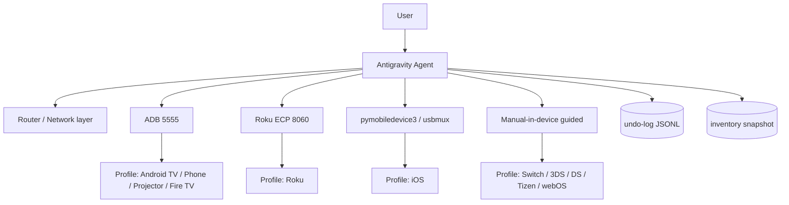

# PLAN — Triển khai bộ tối ưu thiết bị qua IP

> Ngày: 2026-10-19 · Trạng thái: Draft để review · Phạm vi: mọi thiết bị gia đình có IP (TV, Android, iOS, Switch, 3DS/DS, máy chiếu)

## 1. Mục tiêu

Cho phép Antigravity **thấy toàn bộ app của một thiết bị, phân loại, đề xuất tối ưu, xin phép từng bước, áp dụng có thể hoàn tác, rồi đo lại** — tất cả qua IP mạng, không root, không cáp.

## 2. Nguyên tắc thiết kế

| # | Nguyên tắc | Hệ quả thiết kế |
|---|---|---|
| P1 | Không phá huỷ | Mọi thay đổi là *reversible*: `disable` thay vì `uninstall`; setting thay vì xoá file |
| P2 | Minh bạch | Không có "mysterious change"; undo-log là JSON append-only, đọc được bởi người |
| P3 | Hỏi–rồi–làm | Guardrail bắt buộc: không có `approval_token` thì agent không được ghi |
| P4 | Đo lường | Baseline → apply → reboot → verify; metric RAM/boot time/bloat count |
| P5 | Đa nền tảng | Một runbook chung, 9 profile khác transport |
| P6 | Fail-safe | Timeout, probe trước, backup trước, rollback tự động khi verify fail |

## 3. Kiến trúc tổng thể

Bốn *transport* (D1–D4) hội tụ về một *contract* chung: `probe() → inventory() → classify() → plan() → apply(approval) → verify() → rollback()`.

## 4. Lộ trình triển khai

### Phase 0 — Nền tảng tài liệu (tuần 0) ✅ trong repo này
- `PLAN.md`, `SPEC.md`, `RUNBOOK.md`, `SAFETY.md`
- 9 profile thiết bị
- Prompt library
- Templates inventory / change-log / undo

**Exit criteria:** một người chưa từng đọc repo có thể tự tối ưu 1 chiếc Android TV theo `RUNBOOK.md` mà không hỏi thêm.

### Phase 1 — ADB toolkit cho Android (tuần 1)
- `tools/adb.ps1`: `probe | inventory | disable | enable | diff | verify`
- Charset đặc biệt: dùng `pm disable-user --user 0`; bật `adb tcpip 5555` nếu thiết bị cho phép
- Windows-first (PowerShell), fallback pure-Python client như `tv-vibehack/tools/tv.py`

**Exit criteria:** probe + inventory + disable + enable + diff chạy được trên Xiaomi Mi TV và TCL Google TV.

### Phase 2 — Baseline & metrics (tuần 1–2)
- `dumpsys meminfo`, `/proc/meminfo`, `ro.boot.*` boot time, storage
- Báo cáo markdown tự sinh: `reports/<device>_<date>.md`

**Exit criteria:** sinh được báo cáo trước/sau reboot với chênh lệch RAM ≥ đo được.

### Phase 3 — Guardrail & approval engine (tuần 2)
- Parse `docs/SAFETY.md` → deny-list theo package pattern
- Approval token sinh từ `ask_question`, ghi vào undo-log cùng timestamp

**Exit criteria:** agent thử disable `com.google.android.gms` → bị chặn tự động.

### Phase 4 — Home screen launcher (tuần 2–3)
- Đóng gói launcher tối giản (pitch-black, clock, dock app, không ads/recommendation)
- `cmd package set-home-activity`, giữ launcher gốc ở trạng thái `enabled` để undo 1 lệnh
- Tắt animation, screensaver, đặt sleep 5 phút

**Exit criteria:** home screen sạch, nhấn HOME bất kỳ lúc nào đều ra launcher mới; quay lại launcher gốc bằng 1 lệnh.

### Phase 5 — Profile không-ADB (tuần 3–4)
- iOS: pymobiledevice3 (developer mode, app list, Low Power/background policy) + hướng dẫn tap
- Roku: ECP screensaver/preferences
- Switch/3DS/DS: guided settings + router blocking (NTP/Nintendo CDN)
- Tizen/webOS: hướng dẫn theo model + network-layer

**Exit criteria:** mỗi profile có ít nhất 1 hành động **tự động** qua IP, phần còn lại là guided có checklist.

### Phase 6 — Network layer (tuần 4)
- Ad-blocking DNS / Pi-hole cho cả nhà
- DHCP reservation theo IP tĩnh cho từng thiết bị
- QoS ưu tiên thiết bị giải trí lúc tối (đặc biệt khi có TV + máy chiếu cùng Wi-Fi)

**Exit criteria:** ad-domain bị chặn ở tầng DNS, không cần app nào trên TV.

### Phase 7 — Đóng gói & lặp lại (tuần 5)
- `run.ps1` end-to-end cho 1 thiết bị
- Máy trạng thái "đã tối ưu" để chạy lại idempotent

**Exit criteria:** chạy 2 lần liên tiếp không gây thay đổi lần 2 (idempotent).

## 5. Milestone & rủi ro

| Rủi ro | Mức | Giảm thiểu |
|---|---|---|
| Bricking TV không có app để dùng | Cao | Deny-list launcher/system; luôn giữ ≥1 đường quay lại; reboot ngay sau khi disable launcher phụ |
| Mất remote do tắt Bluetooth | Cao | Bluetooth nằm trong deny-list tuyệt đối |
| Tắt nhầm app HDMI | Trung bình | Bắt buộc user xác nhận từng app trong nhóm "input/HDMI" |
| iOS không tự động được | Cao (sai kỳ vọng) | Capability tier ghi rõ; chỉ hứa *guided + quan sát*, không hứa *tự động* |
| Device thuộc network khác (AP isolation) | Trung bảu | Bước probe Wi-Fi: nếu fail → hướng dẫn tắt AP isolation / dùng chung SSID |
| Firmware update xoá thay đổi | Thấp | Ghi rõ trong báo cáo; sau update phải chạy lại `verify` |

## 6. Definition of Done (cho từng profile)

- [ ] `probe` xác định đúng họ thiết bị qua IP
- [ ] `inventory` liệt kê toàn bộ app bằng **tên tiếng Anh dễ hiểu**, chia 3 nhóm
- [ ] Đo được memory/storage baseline
- [ ] Mọi thay đổi đi qua approval, ghi undo-log
- [ ] Có `restore` chạy lại được, đã test ít nhất 1 lần thật
- [ ] Có báo cáo trước/sau reboot

## 7. Ngoài phạm vi (non-goals)

- Root, flash firmware, mod bootloader
- Vượt DRM, sửa hệ thống file
- Bẻ khóa console (Switch/DS) — chỉ dùng tính năng chính thức
- Bypass thanh toán/xác thực của bất kỳ dịch vụ nào
