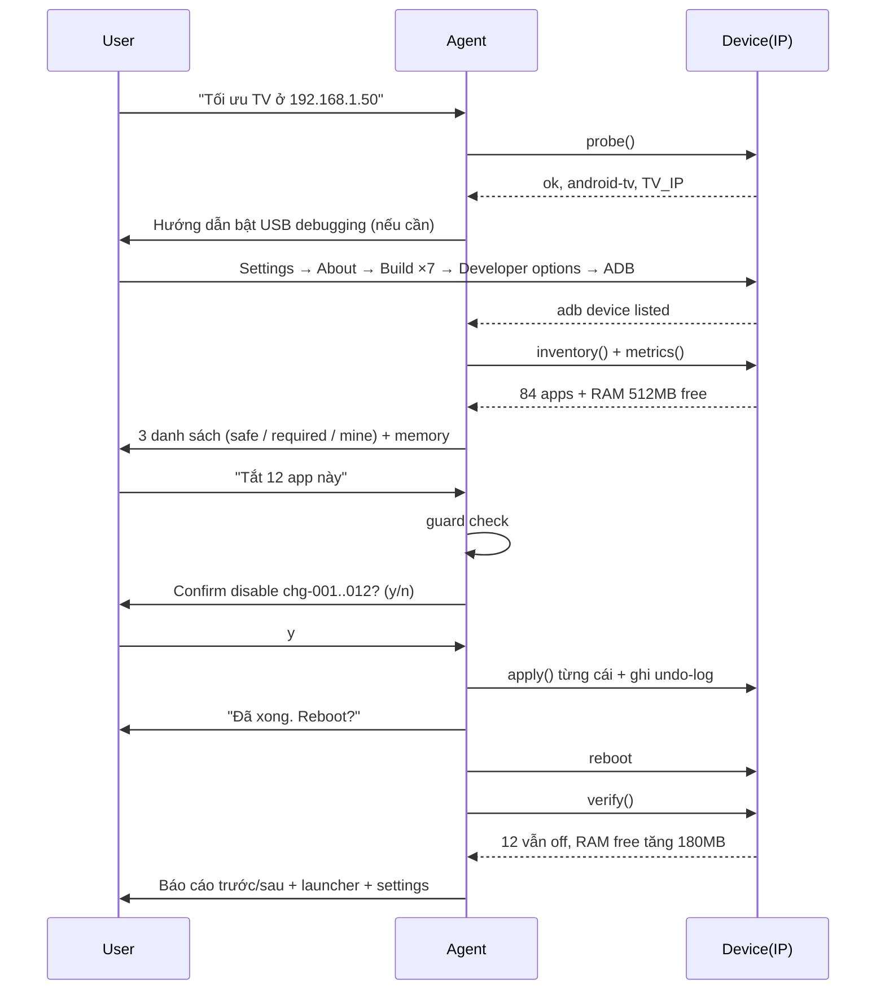

# SPEC — Hợp đồng kỹ thuật

> Bản v1.0 · 2026-10-19 · Phạm vi: agent tối ưu thiết bị qua IP

## 1. Thuật ngữ

| Ký hiệu | Nghĩa |
|---|---|
| `DEVICE` | Một thiết bị đích có IP, ví dụ `192.168.1.50` |
| `PROFILE` | Họ nền tảng: `android`, `android-tv`, `fire-tv`, `ios`, `switch`, `handheld-nintendo`, `roku`, `tizen-webos`, `network` |
| `CAPABILITY` | Khả năng tự động của profile ở tầng IP: `FULL` / `PARTIAL` / `MANUAL` |
| `CHANGE` | Một thay đổi đã áp dụng, có undo được |
| `GUARD` | Quy tắc chặn không được phép chạm |
| `APPROVAL` | Bằng chứng người dùng đã đồng ý cho một `CHANGE` |

## 2. Hợp đồng profile (Profile Contract)

Mọi profile phải hiện thực 7 khả năng sau. Profile `MANUAL` được phép trả `unsupported` nhưng phải kèm hướng dẫn tap tại chỗ.

```text
probe()   -> {ok, device_family, model, os_version, transport, ip}
inventory()-> [ {package_id, plain_name, category, size_mb, is_system, enabled, protected} ]
classify()-> { safe_to_disable[], required_by_device[], user_apps[], unknown[] }
metrics() -> { ram_total_mb, ram_free_mb, ram_used_pct, storage_total_gb, storage_free_gb, uptime_s }
plan(changes) -> [ {id, title, explanation, risk, undo_command, guard_hit? } ]
apply(change, approval) -> {applied, evidence}
verify()  -> {apps_still_disabled, ram_free_mb, boot_ok, launcher_ok}
rollback(all|ids) -> [ {id, status} ]
```

> [!IMPORTANT]
> `classify()` **không được** quyết định một mình. Mọi mục trong `safe_to_disable` là *đề xuất*; người dùng xác nhận trước khi áp dụng.

## 3. Capability tiers

| Tier | Ý nghĩa | Profile nào |
|---|---|---|
| `FULL` | Toàn bộ vòng đời (probe → verify → rollback) tự động qua IP | `android`, `android-tv`, `fire-tv`, `android-projector`, `roku`, `network` |
| `PARTIAL` | Đọc/ghi được một phần; phần còn lại phải tap tay | `ios`, `tizen`, `webos` |
| `MANUAL` | Không có API quản trị qua IP; chỉ hướng dẫn + network-layer | `switch`, `handheld-nintendo`, `ds` |

## 4. Chuẩn inventory (canonical inventory)

Mỗi dòng inventory bắt buộc có 6 trường:

| Trường | Kiểu | Ví dụ | Ghi chú |
|---|---|---|---|
| `package_id` | string | `com.netflix.mediaclient` | id kỹ thuật |
| `plain_name` | string | "Netflix" | **bắt buộc tiếng Anh, dễ hiểu** |
| `category` | enum | `streaming` | xem §5 |
| `size_mb` | number | 412 | có thể `null` |
| `is_system` | bool | false | |
| `enabled` | bool | true | |
| `protected` | bool | false | `true` nếu trúng guard |

## 5. Phân loại app (category taxonomy)

| Category | Ví dụ | Mặc định xử lý |
|---|---|---|
| `launcher` | com.google.android.tvlauncher, com.miui.home | **PROTECTED** — luôn giữ |
| `core` | com.google.android.gms, com.android.vending, SystemUI | **PROTECTED** |
| `input-hdmi` | com.android.tv.leanback, HDMI switcher, Chromecast | **PROTECTED** |
| `keyboard` | com.google.android.inputmethod.latin, AOSP LatinIME | **PROTECTED** |
| `bluetooth` | com.android.bluetooth | **PROTECTED** |
| `ads-telemetry` | ads IDs, analytics, telemetry, crashlytics | đề xuất tắt |
| `preinstalled-unused` | game thử, cỡ máy đo, dịch vụ VN bị ẩn | đề xuất tắt |
| `store` | Play Store, app updates | **PROTECTED** |
| `streaming` | Netflix, YouTube, Prime | hỏi user |
| `games` | | hỏi user |
| `user-installed` | app người dùng tự cài | hỏi user |
| `unknown` | không xác định được | hỏi user, mặc định giữ |

## 6. Guardrail engine

### 6.1 Deny-list cứng (không bao giờ đề xuất, không cần hỏi)
- Package trong `input-hdmi`, `bluetooth`, `keyboard`, `core`, `store`, `launcher`
- Bất kỳ package nào launcher gốc của nhà sản xuất
- Bất kỳ package nào đang chạy làm HOME activity hiện tại

## 6.2 Soft-guard (cần xác nhận rõ ràng)
- Bất kỳ package có `category=streaming` và là app user *đã từng mở gần nhất* (lastUsed > 30 ngày)
- Bất kỳ package từ nhà sản xuất (OEM) mà không nằm trong danh sách an toàn
- Bất kỳ package mà user nêu tên ngoài deny-list

### 6.3 Hành vi khi trúng guard
1. **Chặn**, không hỏi.
2. Ghi log `guard_blocked` vào undo-log.
3. Báo người dùng bằng ngôn ngữ đơn giản: tên app + lý do + app thay thế an toàn.

## 7. Schema undo-log (append-only JSONL)

```json
{"ts":"2026-10-19T14:03:11+07:00","device":"192.168.1.50","profile":"android-tv","id":"chg-001","target":"com.miui.tvads","action":"disable-user","category":"ads-telemetry","approval":{"granted":true,"question":"Tắt quảng cáo Mi?","at":"2026-10-19T14:03:10+07:00"},"undo":{"cmd":"pm enable com.miui.tvads","kind":"enable"},"status":"applied"}
{"ts":"...","id":"chg-002","action":"setprop","key":"persist.sys.timezone","from":"UTC","to":"Asia/Bangkok","undo":{"kind":"restore-prop","value":"UTC"},"status":"applied"}
```

> [!NOTE]
> Log là append-only và **không bao giờ xoá**. `undo` phải là lệnh/giá trị đủ để khôi phục *đúng trạng thái trước đó*, không phải chỉ "bật lại".

## 8. Vòng đời một phiên tối ưu



## 9. Non-functional requirements

| Yêu cầu | Mức |
|---|---|
| Mỗi lệnh shell có timeout | 15s mặc định, 60s cho build/install |
| Retry | 1 lần cho probe, không retry cho lệnh thay đổi trạng thái |
| Ghi log | mọi lệnh ghi vào undo-log kèm raw output |
| Idempotent | chạy lại 2 lần không sinh thay đổi mới |
| Sandbox | không ghi ra ngoài `DEVICE_IP`, `DEVICE_SCOPE`, profile hiện tại |
| Bảo mật | không lưu token/serial vào log; serial cần cho restore |
| Ngôn ngữ | mọi bản tóm tắt cho user viết bằng **tiếng Anh đơn giản** |

## 10. Mã lỗi chuẩn

| Mã | Nghĩa | Hành vi agent |
|---|---|---|
| `E_NO_ROUTE` | Không ping được IP | Hướng dẫn kiểm tra Wi-Fi/AP isolation |
| `E_ADB_OFF` | ADB tắt | Hướng dẫn bật USB debugging |
| `E_ADB_UNAUTH` | Chưa authorize | Nhắc chấp nhận "Allow USB debugging" trên TV |
| `E_GUARD` | Trúng deny-list | Chặn, giải thích, không hỏi |
| `E_UNAUTH_IP` | Transport cần pairing (iOS) | Hướng dẫn pair + trust |
| `E_MANUAL_ONLY` | Profile chỉ hỏng manual | Chuyển sang guided mode |
| `E_REBOOT_TIMEOUT` | Thiết bị không quay lại sau reboot | Không retry mù; hỗ trợ dapper(*:5555)apper |

## 11. Tiêu chí chấp nhận

- [ ] Với 1 Android TV thật: probe → inventory → classify → apply → reboot → verify → rollback đều chạy hết 1 vòng.
- [ ] Deny-list chặn đúng, kể cả khi user nói "cứ tắt hết".
- [ ] Báo cáo trước/sau có số RAM thật.
- [ ] Rollback trả về đúng trạng thái ban đầu, đã test.

## 12. Ngoài phạm vi của spec

- Giao diện RPC tới `adb` binary cụ thể (thiết kế cho cả pure-Python client)
- Giao thức riêng của từng hãng TV (không cần để đạt DoD)
- Bất kỳ cơ chế bypass licensing/DRM nào
